<!-- ===================== HEADER ===================== -->
<p align="center">
  
</p>

<p align="center">
  <a href="https://x.com/painestx"></a>
  <a href="https://instagram.com/z_z5r"></a>
  <a href="https://tiktok.com/@z_z5r"></a>
  <a href="https://twitch.tv/z_z5r"></a>
</p>

<p align="center">
  
</p>

<br/>

<!-- ===================== ABOUT ===================== -->
<h2 align="center">About Me</h2>

```js
const bandar = {
  name:     "Bandar",
  username: "painest",
  age:      25,
  passion:  "Programming",
  focus:    ["Web", "Mobile", "Backend", "IoT", "Pentesting"],
  os:       "Arch Linux (btw)",
  motto:    "Keep building. Keep learning."
};
```

<br/>

<!-- ===================== TECH STACK ===================== -->
<h2 align="center">Tech Stack</h2>

<p align="center"><sub>LANGUAGES</sub></p>
<p align="center">
  <a href="https://developer.mozilla.org/docs/Web/HTML"></a>
  <a href="https://developer.mozilla.org/docs/Web/JavaScript"></a>
  <a href="https://www.typescriptlang.org"></a>
  <a href="https://www.php.net"></a>
  <a href="https://www.python.org"></a>
  <a href="https://dart.dev"></a>
</p>

<p align="center"><sub>FRAMEWORKS & LIBRARIES</sub></p>
<p align="center">
  <a href="https://react.dev"></a>
  <a href="https://reactnative.dev"></a>
  <a href="https://nextjs.org"></a>
  <a href="https://redux.js.org"></a>
  <a href="https://nodejs.org"></a>
  <a href="https://laravel.com"></a>
</p>

<p align="center"><sub>DATABASES & CLOUD</sub></p>
<p align="center">
  <a href="https://www.postgresql.org"></a>
  <a href="https://www.mysql.com"></a>
  <a href="https://www.mongodb.com"></a>
  <a href="https://firebase.google.com"></a>
  <a href="https://www.heroku.com"></a>
</p>

<p align="center"><sub>HARDWARE & TOOLS</sub></p>
<p align="center">
  <a href="https://www.arduino.cc"></a>
  <a href="https://www.raspberrypi.com"></a>
  <a href="https://www.postman.com"></a>
  <a href="https://insomnia.rest"></a>
  <a href="https://www.npmjs.com"></a>
  <a href="https://powerbi.microsoft.com"></a>
</p>

<p align="center"><sub>SECURITY & PENTESTING</sub></p>
<p align="center">
  <a href="https://portswigger.net/burp"></a>
  <a href="https://nmap.org"></a>
  <a href="https://www.metasploit.com"></a>
  <a href="https://www.wireshark.org"></a>
  <a href="https://sqlmap.org"></a>
  <a href="https://www.zaproxy.org"></a>
  <a href="https://github.com/OJ/gobuster"></a>
  <a href="https://github.com/vanhauser-thc/thc-hydra"></a>
  <a href="https://www.openwall.com/john/"></a>
  <a href="https://www.tenable.com/products/nessus"></a>
</p>

<p align="center"><sub>OS & PLATFORMS</sub></p>
<p align="center">
  <a href="https://archlinux.org"></a>
  <a href="https://www.kernel.org"></a>
  <a href="https://www.gnu.org/software/bash/"></a>
  <a href="https://www.torproject.org"></a>
  <a href="https://tryhackme.com"></a>
  <a href="https://www.hackthebox.com"></a>
</p>

<br/>
<!-- ===================== SNAKE ===================== -->
<p align="center">
  <picture>
    <source media="(prefers-color-scheme: dark)" srcset="https://raw.githubusercontent.com/painest/painest/output/github-snake-dark.svg"/>
    <source media="(prefers-color-scheme: light)" srcset="https://raw.githubusercontent.com/painest/painest/output/github-snake.svg"/>
    
  </picture>
</p>

<!-- ===================== STATS ===================== -->
<h2 align="center">GitHub Stats</h2>

<p align="center">
  
  
</p>

<p align="center">
  
</p>

<p align="center">
  
</p>

<br/>


<!-- ===================== QUOTE ===================== -->
<p align="center">
  
</p>

<!-- ===================== FOOTER ===================== -->
<p align="center"><sub><code>$ exit</code> — thanks for visiting</sub></p>
